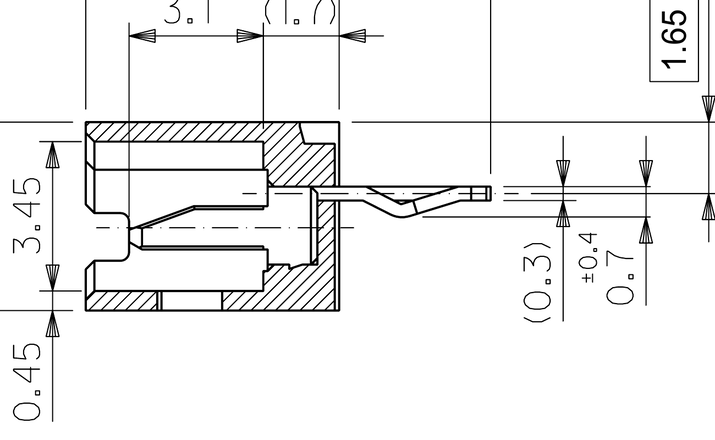
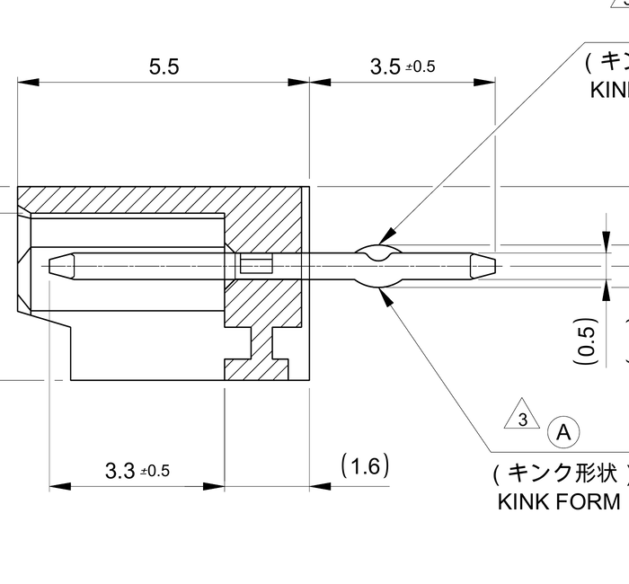
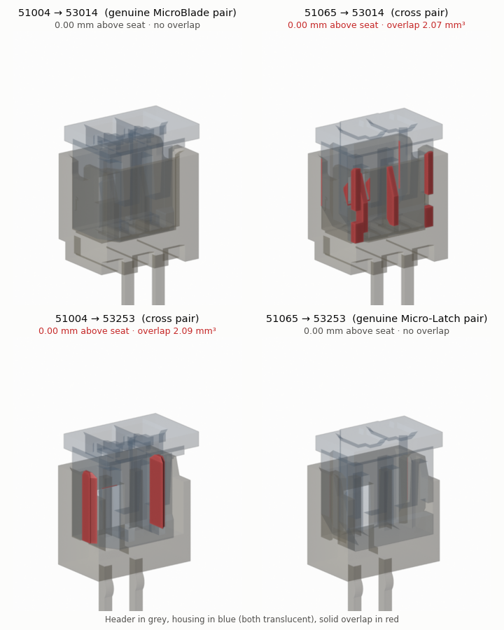

# Can a Molex 53253 (Micro-Latch) header stand in for a 53014 (MicroBlade) header?

*Mating study for the AYAB interface's 2 mm machine connectors (J2C–J6C), 26 October 2026*

## Verdict

**No. The two systems do not mate in either direction.** A MicroBlade cable housing (51004) does not fit onto a Micro-Latch header (53253). A Micro-Latch housing (51065) does not fit onto a MicroBlade header (53014). Molex's own obsolescence notice says the same thing: it lists 53253 as the successor to 53014, but as a *"Replacement with differences"*, not a *"Drop in replacement"*. The cable housing changes in the same notice.

Three independent lines of evidence agree:

1. **Molex documentation.** PCNs 509450/509547 move the header, the housing *and* the terminal to Micro-Latch together (details in [Molex documentation](#1-molex-documentation)).
2. **Contact geometry.** MicroBlade uses a **0.32 × 1.0 mm flat blade**. Micro-Latch uses a **0.5 mm square pin**. Each system's housing has an entry hole sized for its own contact (details in [Contact geometry](#2-contact-geometry-from-the-drawings)).
3. **3D collision study on Molex's own CAD models.**
   - The two genuine pairs seat with zero overlap.
   - Both cross pairs jam with 0.3–0.4 mm of rigid overlap, over several millimetres of height.
   - Details in [3D collision study](#3-3d-collision-study).

No first-hand report of anyone mating these parts turned up, either successfully or not.

*Each cable housing is lowered onto each header. Diagonal panels (top-left, bottom-right) are the genuine pairs; the other two are the cross pairs. Red = solid overlap between the parts.*

---

## Terminology: which part is the "plug"?

Molex's naming runs the opposite way to the usual intuition, so it's worth being precise:

| Role | MicroBlade 2.0 (obsolete) | Micro-Latch 2.0 (successor) |
|---|---|---|
| PCB header, male contacts | **53014** vertical "wafer" (also 53015 right-angle) | **53253** vertical "plug assembly" (also 53254 right-angle) |
| Cable housing, female terminals | **51004** "receptacle housing" | **51065** "receptacle housing" |
| Crimp terminal | 50011 (box socket) | 50212 (or 503728) |
| Header contact | flat **blade**, 0.32 mm thick | **square pin**, 0.5 × 0.5 mm |
| Status | Header obsolete since 2021-09-21; housing NRND | Active |

So the practical question for the AYAB board is whether a **53253 header** can be soldered in where a **53014** goes, and still accept the cable that was made for the 53014, which is a **51004** housing. The reverse case (a 51065 cable onto a 53014 header) was checked too.

*Left: 51004 housing over a 53014 header. Right: 51065 housing over a 53253 header. Both are rendered from Molex 3D models (2-circuit).*

---

## 1. Molex documentation

**PCN 509450** (issued 2020-09-21) and its correction **PCN 509547** (2020-10-16) made the MicroBlade headers obsolete. Last-time-buy was 2021-06-21 and last ship 2021-09-21. The replacement lists say:

| Obsolete part | Molex replacement | Molex's classification |
|---|---|---|
| 53014-0310 (3-ckt header) | 53253-0370 | Replacement **with differences** |
| 53014-0210 (2-ckt header) | 53253-0270 | Replacement **with differences** |
| 51004-0300 (3-ckt housing) | 51065-0300 | Replacement **with differences** |
| 51004-0200 (2-ckt housing) | 51065-0200 | Replacement **with differences** |

Molex's spreadsheet offered three options: "Drop in replacement", "Replacement with differences" and "No replacement part". None of the MicroBlade parts are classed as drop-in.

The original PCN 509450 list was off by one circuit (for example, 53014-0310 → 53253-0270). PCN 509547 exists only to correct that. The old AYAB BOM alternates were also mismatched: it listed 53253-0870 against the 3-pin 53014-0310. The current 53014-0310 product page adds: *"Replacement p/n 532530370 … has different size, use with and mate with parts"*.

Each part's spec sheet names only its own system as a mate:
- **53014 header:** "Mates with 51004". Drawing SD-53014-001 rev J, note 1.
- **53253 header:** "Mates with Micro-Latch Receptacle Housing 51065". Product spec 510650000-PS lists 50212/503728 terminals, 51065 housing, and 53253/53254 headers as a single system.

---

## 2. Contact geometry (from the drawings)

| | 53014 MicroBlade header | 53253 Micro-Latch header |
|---|---|---|
| Contact | Flat blade, phosphor bronze, t = 0.32 mm, ≈1.0 mm wide | Square pin, brass, 0.5 × 0.5 mm |
| Exposed contact above floor | 3.1 mm | 3.3 mm |
| Shroud | Four walls, 4.35 × (n·2 + 2) mm outer, 3.45 mm inner depth | Three walls (front open), 3.65 mm deep, 3.15 mm inner |
| Height above PCB | 5.85 mm | 5.5 mm |
| Retention | Window in one long wall, for a bump on the housing | Window in the back wall for the housing's ramp, plus friction nibs on both end walls |
| Contact position | Blade centre 1.39 mm from the latch-wall inner face | Pin centre 1.0 mm from the back-wall inner face |
| PCB hole (recommended) | Ø0.8–0.9 mm | Ø0.8 mm |

The cable-side entries are sized to match:
- **51004:** blade slot **0.5 × 1.3 mm**
- **51065:** square entry **0.62 × 0.62 mm** (510650000-SD)

| 53014 section (SD-53014-001) | 53253 section (532530000-SD) |
|---|---|
|  |  |

*Left: the 53014 blade sits in a pocket with clearance slots on either side for the housing walls. Right: the 53253 has a plain square pin in an open-front shroud.*

*53014 top view. The thin rectangle beside each post is the blade's 0.32 × ~1.0 mm cross-section.*

What this means for each direction:

- **51065 onto 53014.** A 1.0 mm-wide blade cannot pass through a 0.62 mm entry, wherever the housing sits. This is a hard stop.
- **51004 onto 53253.** The pin is 0.5 mm in both directions. The blade slot is 0.5 mm in X, and the pin only lines up at the extreme edge of the slot's 1.3 mm in Z. The fit is line-to-line, with no clearance at all.
  - Behind the slot sits a 50011 box contact designed to grip a **0.32 mm** blade. A 0.5 mm pin has to spread it about 0.18 mm further than it was designed for.
  - This is an inference: I had no 50011 drawing. Expect either refusal to enter or permanent set and poor contact afterwards.

---

## 3. 3D collision study

### Models

| Part | Source | Changes made for the study |
|---|---|---|
| 53014-0310 | Molex 3D model `530140310` (2014), already in this repo at `ayab-library/packages3D/53014-0310.stp` | Reduced to 2 circuits |
| 53253-0370 | Molex STEP from molex.com | Reduced to 2 circuits |
| 51065-0300 | Molex STEP from molex.com | Reduced to 2 circuits; the model has no terminal cavities, so the drawing's 0.62 mm square entries were added, 4 mm deep |
| 51004-0200 | Molex model `510040200` (2013), redistributed by SamacSys | The model only has blade slots at the mating face; they were extended 4.4 mm deep at the same 0.5 × 1.3 mm |

**Pitch removal.** Three parts were reduced from 3 to 2 circuits by deleting one pitch between the mid-pitch planes. Because the parts are periodic, this is exact. It was checked against the drawings: the 53014's 3.4 mm latch window becomes 1.4 mm, which is exactly the 2-circuit value on SD-53014-001.

**Method.**
- All four parts were placed in a common frame. Header: PCB at height 0. Housing: latch face against the header's latch wall.
- Each housing was lowered onto each header in 0.25 mm steps, from 4 mm above seated down to fully seated.
- At each step, the solid intersection was computed in FreeCAD (OpenCASCADE booleans).
- The housing's sideways position in the depth direction was optimised (±0.6 mm) to give it the best chance.

**Validation.** Both genuine pairs seat with **zero** overlap. The only interference on the way down is a transient 0.3–0.37 mm while the latch ramp or bump rides over the shroud wall. That is the designed snap action, and it disappears once the latch reaches its window.

| Pairing | Seats? | Deepest overlap when seated | What collides |
|---|---|---|---|
| 51004 → 53014 (genuine) | Yes | 0 | Nothing. Latch bump flexes 0.30 mm during insertion, then snaps in. |
| 51065 → 53253 (genuine) | Yes | 0 | Nothing. Latch ramp flexes 0.37 mm during insertion, then snaps in. |
| **51004 → 53253** | **No** | **0.30 mm** | The 53253's friction-lock nibs cut 0.30 mm into **both ends** of the 51004 over the full 3.9 mm shroud height (≈1.0 mm³ per end). The 51065 has V-grooves for these nibs; the 51004 has none. The pins also reach the blade slots with zero clearance. |
| **51065 → 53014** | **No** | **0.41 mm** | Every blade overlaps the 0.62 mm entry by 0.32 mm along its whole 3.1 mm length. Internal corner ledges of the 53014 overlap the 51065 by 0.4–0.55 mm. The ramp also clips the latch-window edges. |

The 3-circuit case was also run with unmodified Molex models (51065-0300 into 53014-0310). All three blades were blocked by 0.32 mm, and the corner ledges overlapped by 0.46–0.56 mm.

*Horizontal section 0.8 mm above each header's floor. Bottom-left (51004 → 53253): the red wedges are the 53253 friction nibs inside the 51004's end walls; the square pins sit exactly on the edge of the blade slots. Top-right (51065 → 53014): the blades overrun the 0.62 mm entries, and the corner ledges overlap the housing.*

*Vertical section through contact 2. Top-right: the 53014 blade (part of the beige header body) runs into solid 51065 plastic.*

---

## 4. First-hand reports

I found **no first-hand report** of anyone trying either cross-mating. I searched forums (EEVblog, Reddit, DigiKey TechForum), distributor Q&A and the AYAB community. What does exist:

- **Distributor cross-references.** Mouser lists 53253-xx70 as a *"possible replacement"* for obsolete 53014 headers (for example 53014-0710 → 53253-0670), with no claim of intermating.
- **Vendor guides.** KONNRA, which sells a competing MicroBlade clone, quotes Molex: *"Replacement part is not a drop in replacement… crimp terminal/50011, housing/51004 and header/53014 & 53015 need to be replaced"*. The PCN files above confirm this.
- **Kit datasheets.** Molex's 76650-0237 kit ships 51004 MicroBlade housings and 53253 Micro-Latch headers side by side as separate families, which suggests nothing about them mating.
- **This repo.** The 53253 alternates were added to the BOM in `d368f23` (2019-11-22, "updated BOM with Mouser part numbers"). Their circuit counts don't match the primary parts, and nothing indicates they were ever tested. That suggests they came from a distributor cross-reference rather than a fit check.

---

## 5. Implications for the AYAB interface

- **J2C/J6C (3-pin, populated): keep the 53014-0310.** As the current BOM update already does, source new old stock. A 53253 on the board would not accept the existing MicroBlade cable housing.
- **To migrate to Micro-Latch, change the cable as well.** The machine-side cable needs 51065 housings with 50212 terminals: a re-crimp, or an adapter cable. Only then can 53253 headers be fitted.
  - The hole pattern is compatible: single row, 2 mm pitch, Ø0.8 mm holes fit the 0.5 mm square tails.
  - The body outline differs: 3.65 mm deep with an open front, versus 4.35 mm closed. The pin row also sits at a different offset within the outline: on the 53253 it is 1.5 mm from the back face; on the 53014 the kinked tail is 1.65 mm from datum face A. So silkscreen and courtyard need updating, and orientation must be checked against the cable.
- **Third-party MicroBlade-compatible headers.** Scondar SCT2002, LDZY A2002 and others are offered as 53014 equivalents. They would keep the existing cables, but they are vendor claims that I have not verified. The same check could be run on them if a STEP model is available.

## Limitations

- **CAD models are simplified.** No terminals are modelled. The cable-side entries were extruded as straight prisms. All dimensions are nominal, with no tolerance stack, and plastic deformation is not modelled.
  - A determined user can probably force a 51004 into a 53253 by flexing or shaving the end walls. That still leaves line-to-line contact alignment and over-spread 50011 contacts, which is not a reliable connection.
  - Nothing short of cutting plastic gets a 1 mm blade into a 0.62 mm hole.
- **The 51004 model comes from a third party** (SamacSys, originally a Molex file from 2013). Its key dimensions agree with the 53014 drawing: blade slot 1.4 mm from the latch face against a blade 1.39 mm from the latch wall, a 5.80 mm mated height, and a body that fits the 3.45 mm cavity with 0.1 mm clearance.
- **The study used 2-circuit parts.** AYAB uses 3, 5, 8 and 10 circuits. The per-pitch interface is identical, and the 3-circuit check above gives the same result.

## Sources

- Molex sales drawings: SD-53014-001 rev J (530140310_sd.pdf), 532530000-SD rev A, 510650000-SD rev C. Product specs: 510650000-PS / 510651000-PS (Micro-Latch) and PS-51004-002 rev C (MicroBlade, via [Jameco's copy of the Molex datasheet](https://datasheet.octopart.com/51004-0700-Molex-datasheet-10036579.pdf)).
- Molex PCN 509450 and PCN 509547, with their replacement-part spreadsheets.
- Molex part spec sheets: [53253-0570](https://www.farnell.com/datasheets/1868930.pdf), [53253-0970](https://assets.testequity.com/te1/Documents/pdf/Molex/Molex_53253-0970_Header-and-Wire-Housing_Datasheet.pdf).
- [Misumi 53014 listing](https://my.misumi-ec.com/vona2/detail/222000609933/) (mates with 51004 / 50011).
- [Mouser 53014-0710](https://www.mouser.com/ProductDetail/Molex/53014-0710?qs=rew4TcUmwq9d3ROd99smSw%3D%3D) ("possible replacement" 53253-0670).
- [KONNRA MicroBlade guide](https://konnra.com/molex-microblade-2-0-connector-complete-guide/).
- Molex kit datasheet [76650-0237](https://www.farnell.com/datasheets/525627.pdf).
- 3D models: Molex 532530370.stp and 510650300.stp (molex.com); 530140310 (repo `ayab-library/packages3D/53014-0310.stp`); 510040200 (SamacSys LIB_51004-0200).
