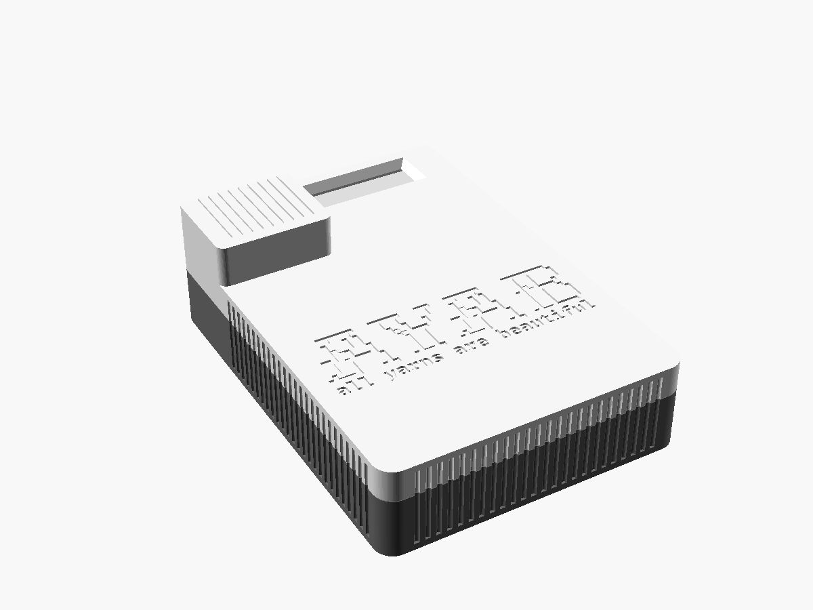
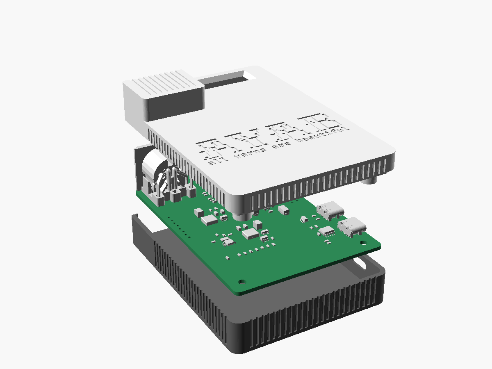

# 3D-printed enclosure for the ayab-sr-esp32 board

Three-piece enclosure (tray, lid, and a DIN cap glued onto the lid) for the `ayab-sr-esp32` board. The `.scad` is
written in the placement frame of commit d8073cd (before the board was rotated by 90°;
`board_frame()` puts it back into the current frame), updated for the lengthened board
(6 mm then 8 mm at the bottom: 64.5 × 97.1 mm), the H1/H3 holes in the two bottom corners and
H2 near the right edge below the OLED, and for the OLED mounted on a 5 mm low-profile socket J15.
Mapping: current board (x, y) = .scad frame (y + 75.9, 215 − x).




| File | Contents |
|---|---|
| `ayab-sr-esp32-enclosure.scad` | Parametric OpenSCAD source (parameters at the top of the file) |
| `bottom.stl` | Tray, in print orientation (floor on the bed) |
| `lid.stl` | Lid, in print orientation (top on the bed) |
| `cap.stl` | DIN cap, in print orientation (top on the bed) |
| `mast-attachment.stl` | Bracket for mounting on a mast (Ø 8 mm hole), in print orientation |
| `ayab-logo-letters.svg`, `ayab-logo-fills.svg` | AYAB logo on the lid: letters and tagline, letter fills |
| `renders/` | Still views, `turntable` and `exploded` animations (GIF, `quick_render.py --anim`) |
| `tools/` | Python scripts (numpy/PIL) for the fit check, the sections and the renders (OpenSCAD OpenGL preview) |

Outside dimensions: **101.7 × 69.3 × 20.8 mm**, **30.3 mm** at the top of the DIN hump
(tray 13.65 mm; lid: 7 mm above the joint, hump 16.5 mm above the joint).

## Design choices

- **Frame**: X = KiCad x, Y = −KiCad y, Z = 0 under the PCB. All positions in the `.scad`
  are typed in KiCad coordinates (`kp()`, `krect()`), so they can be copied
  straight from the PCB.
- **Low top + DIN hump**: the ceiling is 12.8 mm above the underside of the PCB, just
  above the OLED glass (11.74 mm, the tallest part after the DIN: the module
  is plugged into the 5 mm J15 socket, on its 2.5 mm pin spacer); top at
  14.8 mm. The tray/lid joint stays at 7.8 mm, so the lid has 5 mm walls.
- **Support under the OLED**: the PCB is cut along the antenna cut-out (x = 158.9)
  up to the top edge; the end of the module opposite the pins therefore overhangs the PCB and rests
  on a rectangular block of the tray (KiCad x 159.3–165.0, y 27.0–37.6, against the wall),
  whose top is 0.1 mm below the module (z = 9.0). Only the **DIN J3** (top at 21.25 mm) sticks out: a 20 × 23 mm hump
  covers it (ceiling 22.3 mm, top 24.3 mm), in the back right corner. Above the joint, the block
  stops 0.2 mm from the lid wall.
- **DIN cap**: the hump is split from the lid at the level of the lid top (z = 14.8 mm)
  and glued on. A 1.1 × 1 mm tongue under the cap, within the wall thickness,
  locates it (0.15 mm clearance). The glue joint takes no load: the plug pushes on the
  socket, which is soldered to the PCB. This way the lid and the cap both print without supports.
- **J4 and J14 are not fitted** (DNP in the schematic and the PCB): no openings
  for them; they are left out of the renders and of the fit check.
- **Walls** 2 mm, 0.3 mm clearance around the PCB, 0.5 mm on the USB/antenna side (the ESP32 module
  overhangs the edge by 0.16 mm). The outline follows the top-right notch, where it stops
  flush with the face of the DIN (see below).
- **Fastening**: 3 **M3×12 countersunk screws (ISO 10642 / DIN 7991)** inserted from
  **below**: countersink in the tray → standoff (4 mm) → PCB hole → **heat-set brass
  M3 insert** at the end of a lid column (Ø 6.6 mm). The PCB is clamped
  between the standoff and the column; the top of the lid stays smooth. The walls have
  0.15 mm of clearance at the joint: the PCB takes the clamping force.
  Variant without inserts: `use_inserts = false` → Ø 2.5 hole for an M3 self-tapping screw
  (or a 3×12 plastic screw). No metal near the antenna (inserts at H1, H2, H3, far away).
- **Tray / lid joint at z = 7.8 mm** (the ceiling): the USB-C sockets are entirely in the tray
  (9.6 × 3.9 mm holes, centred on the shells measured in the 3D export, ~0.35 mm
  margin), with a **shared outside pocket** 1.2 mm deep (0.8 mm wall left) for
  the cable overmoulds (the two sockets are 14.8 mm apart, like the ports of a MacBook: dual USB-C plugs for MacBooks fit).
  "PWR" (J1, USB-PD) and "ESP32" (J2) engraved under the sockets.
- **DIN J3**: **nothing in front of the socket**. The enclosure stops flush with its front face
  (x = 181.7) across the whole width of the PCB notch (y < 48.0): no wall, and the
  tray, the hump and the back wall all stop at the same plane. The OLED /
  wheel compartment, which sticks out to the side, is closed along the edge of the notch:
  below the PCB by a 2 mm wall (**trim the OLED module pins flush under the board**
  after soldering), above it by a 0.45 mm skirt of the lid, stopping 0.4 mm short of the tray wall below the joint (a slot
  lets the edge of the OLED module's board through, 0.13 mm from the edge of the notch).
- **Thumb wheel S1**: it reaches x = 193.7, beyond the wall: the slot in the tray
  is **open at the top** (the board is lowered vertically, the wheel goes into
  the slot) and a **tab on the lid** closes it from above (z ≥ 4.6, wheel ≤ 4.1).
  A 1 mm pocket in the outside face (y 55.5..77.8) clears the wheel: it
  sticks out 2.6 mm from the bottom of the pocket (1.6 mm from the outside face). The slot is 0.8 mm wider than the wheel on each side.
- **OLED U5**: the glass is 1 mm below the lid plate; 7.1 × 23.9 mm window
  (active area + 0.75 mm) through the plate, chamfered at 45° outwards.
- **ESP32 antenna**: no insert or screw nearby.
- **Ribs**: half-round vertical grooves (1.2 mm wide, 0.6 mm deep, 2.4 mm pitch),
  like a knitted rib edge, on the free walls (left, top, and the USB side past the
  pocket), continuous across the joint, with a 1.5 mm smooth band at the bottom of the tray and at the
  top of the lid. 1.4 mm of wall left. No ribs around the cap joint, where the
  wall is already down to 0.75 mm. Cap top: 9 grooves 0.5 mm deep, open towards the DIN.
- **AYAB logo**: engraved on the lid, 60 mm wide, readable with the DIN at the top. Letters and
  tagline 0.5 mm deep, letter fills 0.2 mm (one layer), to keep the
  logo design in a single colour.
- **Locating lip** 2 mm under the lid (left, top and bottom sides), absent
  along the right side (OLED, wheel) and around the DIN.

## Printing

- Material: PETG recommended (PLA possible, but then avoid long use in sun/heat).
- 0.4 mm nozzle, 0.2 mm layers, 3 perimeters, 20 % infill.
- `bottom.stl`: floor on the bed. The 90° countersinks and the USB holes (short
  9.6 mm bridge) print without supports.
- `lid.stl`: **top on the bed, no supports** (turn off "Generate Support":
  otherwise Cura puts some in the engraving). The walls, the lip, the columns, the skirt and the
  wheel tab all rise from the plate. The logo is on the bed face:
  watch out for elephant's foot, which can fill in the tagline.
- `cap.stl`: **top on the bed, no supports**.
- Inserts: set them with a soldering iron (≈ 220 °C for PETG) into the columns before assembly.
- Cap: test-fit dry, then glue with cyanoacrylate or epoxy (sand the faces on PETG).

## Hardware

- 3 × M3×12 countersunk screws (ISO 10642 / DIN 7991) — M3×14 also fits.
- 3 × heat-set brass M3 inserts (outer Ø 4.6–5.0 mm, length ≤ 5.7 mm, Ø 4.0 hole).
- Cyanoacrylate or epoxy glue for the DIN cap.
- Optional: 4 adhesive feet under the tray.

## Assembly

1. Set the 3 inserts into the lid columns and glue on the DIN cap.
2. Lower the board vertically into the tray: the wheel goes into the open slot,
   the USB-C sockets line up behind their holes, the DIN behind its half-hole.
3. Fit the lid (the tab closes the wheel slot, the lip centres it).
4. Turn the assembly over while holding it, and drive the 3 M3 screws from below without forcing.

## Checks done (digital)

- 3D export of the board with `kicad-cli` (STEP, GLB, per-component STL); S1 has a STEP built
  from the manufacturer's dimensioned drawing (`ayab-library/packages3D/generators/sw_smd_bl_dt_step.py`).
- Tray, lid and cap: no overlap between parts (empty intersection in OpenSCAD).
- `tools/fitcheck.py`: no point of the fitted components or of the PCB inside the parts;
  clearances under 0.3 mm only where intended (DIN face / wall 0.2 mm;
  OLED module / tray support 0.1 mm; ESP32 antenna / wall 0.34 mm).
- `tools/openings_check.py`: USB-C shells in their holes with 0.33 mm (x) and
  0.36 mm (z) of margin; wheel y 60.6..72.7 in a slot y 58.4..74.9; OLED at 11.74,
  ceiling at 12.8; DIN: no part of the enclosure in front of the face.
- 2D sections: `tools/sections.py` (images not kept in the repo).

## Limitations / to check on the first print

- **DIN cap**: fit of the tongue (0.15 mm clearance) and strength of the glue joint to
  check. The lip around the opening in the lid is 0.75 mm thick and 1.15 mm high.
- Shorter columns (6.2 mm): 6.5 mm insert hole, the tip of an M3×12 screw
  reaches 6.0 mm; don't use screws longer than M3×12.
- The DIN (DIN-704-M10) and OLED module models come from the library: check
  on the real parts the height of the DIN and the actual height of the OLED on its
  J15 socket and 2.5 mm spacer (H2 column 2.9 mm from the module).
- A DIN plug with a bulky overmould may touch the side of the OLED compartment (11 mm
  from the socket axis); the 0.45 mm skirt that closes this compartment is fragile, to
  check on the first print.
- USB-C: overmoulds larger than 13 × 7.6 mm are not accommodated; two very thick cables side by side
  may get in each other's way (sockets 14.8 mm apart).
- Thumb wheel S1: model built from the scaled datasheet drawing (Ø 14.6 rim, 2.5 high);
  check the actual protrusion and height of the wheel (lid tab at z = 4.6).
- No ventilation (switching regulators + ESP32: keep an eye on it in long use).
- The enclosure only depends on the placement, the H1, H2, H3 holes and the outline; re-check it if
  any of these change.

## Regenerating

```sh
openscad -D 'part="tray_print"' -o bottom.stl ayab-sr-esp32-enclosure.scad
openscad -D 'part="lid_print"'  -o lid.stl    ayab-sr-esp32-enclosure.scad
openscad -D 'part="cap_print"'  -o cap.stl    ayab-sr-esp32-enclosure.scad
openscad -D 'part="mast_attachment"' -o mast-attachment.stl ayab-sr-esp32-enclosure.scad
# part = "assembly" | "exploded" | "tray" | "lid" to view in OpenSCAD
# ("lid": lid and cap in one piece, for the fit check and the viewer)
```

The script that runs everything (STLs, KiCad exports, fit check, renders) is on the
`tooling` branch. The scripts in `tools/` (Python 3 + numpy + PIL) work in a folder
containing `board.glb`, `pcb_only.stl`, `comp/<REF>.stl`, `tray_asm.stl` and `lid_asm.stl`.
