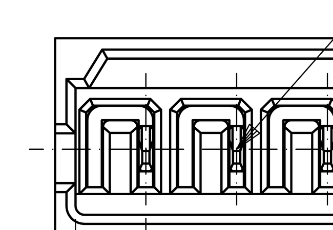
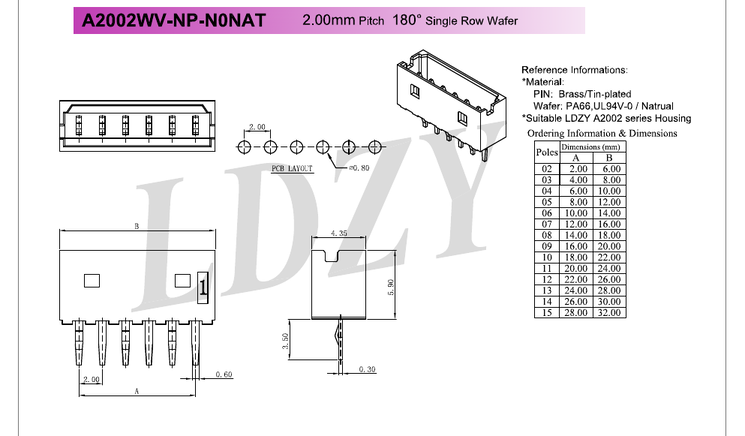
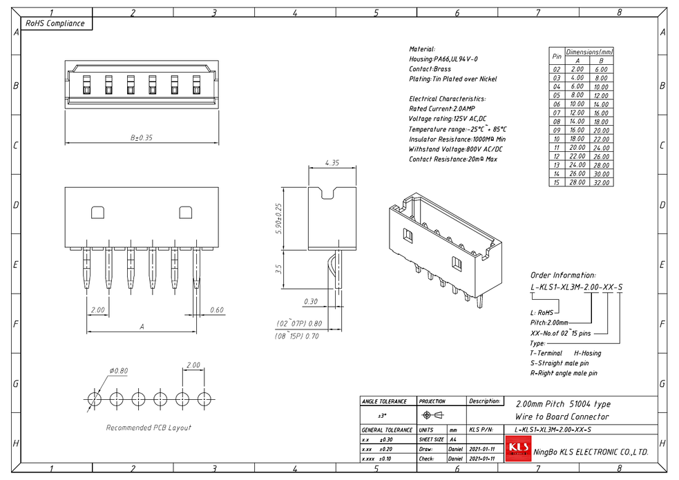
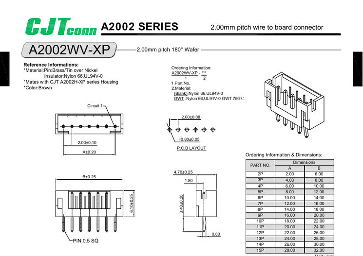
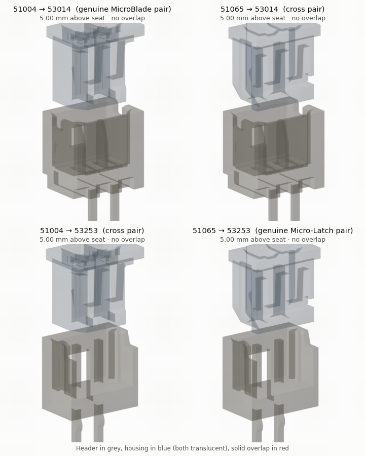
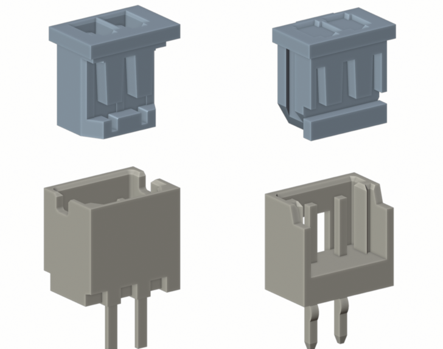
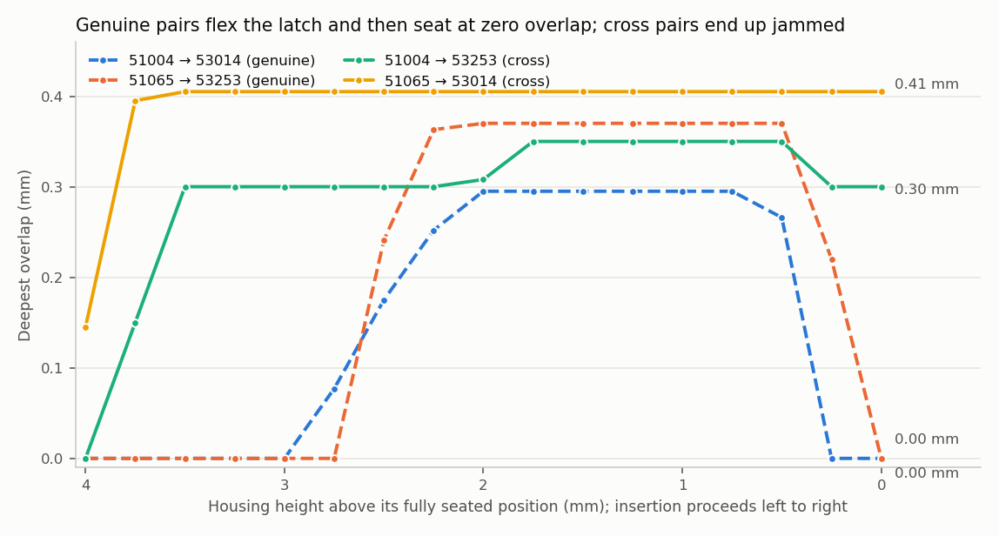
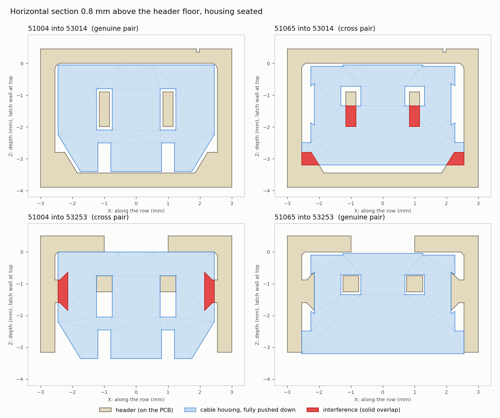
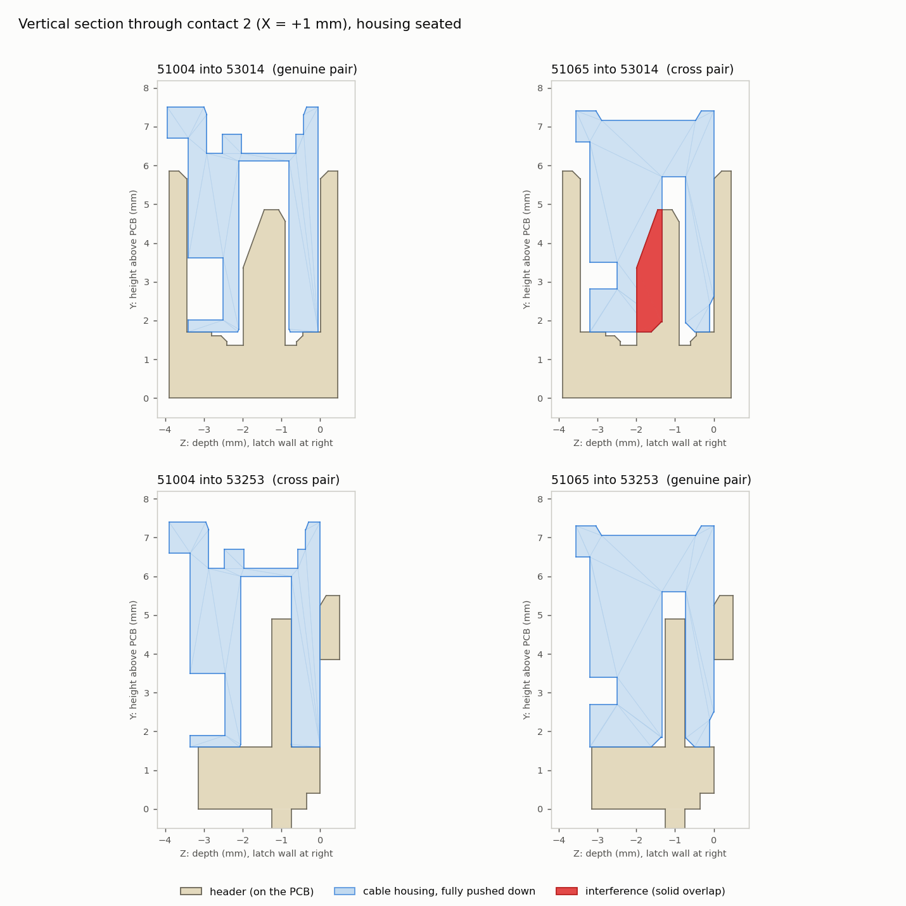

# Sourcing 2 mm headers for KH-900 / KH-965 / KH-270 machine cables

*All AYAB hardware for Brother machines (`ayab-interface`, `ayab-shield`, `ayab-esp32`) · research notes, 26 October 2026*

Every AYAB board in this repository installs into a Brother knitting machine and connects to the machine's own cables. On the KH-900, KH-965 and KH-270, those cables end in 2 mm-pitch housings with 3, 5, 8 and 10 positions, so the boards need matching 2 mm headers. All three boards were designed around **Molex 53014 MicroBlade** headers, which Molex made obsolete in 2021. This document looks at how to keep sourcing headers that mate with the machine cables' housings.

## Summary

| Option | Mates with the machine cable? | Availability (Oct 2026) | Verdict |
|---|---|---|---|
| **Genuine Molex 53014** | Yes, it's the original design | Obsolete; authorised stock only for the 10-pin, in large minimums; brokers hold thousands of every size | **Primary choice** while broker stock lasts ([section 2](#2-genuine-molex-53014)) |
| **CJT A2004WV-3/5/8P, CNJM CNJMA2004WV-10P** (MicroBlade copies) | Expected: the drawings match the 53014 dimension for dimension. Not yet test-fitted | Stocked at LCSC, about $0.09–0.13 each | **Alternate, after a sample fit check** ([section 3](#3-third-party-microblade-copies)) |
| Other copies (XKB X2012WV, LDZY A2002WV-NP, KLS1-XL3M-S, …) | Probably, on paper | Patchy at LCSC, or direct quotes only | Fallback |
| **Molex Micro-Latch 53253** (Molex's official successor) | **No.** It doesn't mate in either direction | Active, widely stocked | **Do not use** unless the cables are re-terminated too ([section 4](#4-molexs-successor-micro-latch-53253-does-not-mate)) |
| CJT **A2002**WV and other square-pin "2.0 mm wafers" | No, they have square pins | Widely stocked | **Do not use** |

What to do next is in [section 5](#5-sourcing-comparison-and-recommendation).

---

## 1. The 2 mm machine connectors on AYAB boards

| Pins | `ayab-interface` (gEDA) | `ayab-shield` (KiCad) | `ayab-esp32` (KiCad) | Molex part |
|---|---|---|---|---|
| 3 | J2C, J6C ("KH-965") | JPB2 | J411, J412 ("900.965 EOL L/R"), footprint `CONN-TH_3P-P2.00_A2004WV-3P` | 53014-0310 |
| 5 | J3C ("KH-965") | JPB8 | J413 ("900.965 ENCODERS") | 53014-0510 |
| 8 | J4C ("KH-900") | JPB3 | J402 ("900.965.CK35 SOLENOIDS B") | 53014-0810 |
| 10 | J5C ("KH-900") | JPB4 | J401 ("900.965.CK35 SOLENOIDS A") | 53014-1010 |

*Labels in quotes are the schematic's own. The shield's 3-pin JPA7 is a 2.5 mm SPOX position on a combined footprint and is out of scope here.*

**All of these positions may be populated.** On `ayab-interface`, the BOM's "DO NOT POPULATE" on J3C/J4C/J5C only reflects that these parts are sourced outside automated assembly.

**The A2004WV footprint is already in the repo.** `ayab-esp32` already uses a CJT A2004WV-3P footprint for its 3-pin positions (`ayab-library/Library.pretty/CONN-TH_3P-P2.00_A2004WV-3P.kicad_mod`, plus a 5-pin `CONN-TH_A2004WV-5P`). So the copy recommended in [section 3](#3-third-party-microblade-copies) has already been chosen once in this project.

The header has to accept the housing on the machine cable. Since the boards were designed around the 53014, that housing is a **MicroBlade 51004-type** receptacle with box terminals that grip a flat blade. Any replacement header must therefore reproduce the 53014's mating interface: a flat blade about 0.32 mm thick and about 1.0 mm wide, in a 4.35 mm-deep, four-wall shroud, with the latch window in the same place.

The two Molex 2 mm families involved, and Molex's naming for them:

| Role | MicroBlade 2.0 (obsolete) | Micro-Latch 2.0 (successor) |
|---|---|---|
| PCB header, male contacts | **53014** vertical "wafer" (also 53015 right-angle) | **53253** vertical "plug assembly" (also 53254 right-angle) |
| Cable housing, female terminals | **51004** "receptacle housing" | **51065** "receptacle housing" |
| Crimp terminal | 50011 (box socket) | 50212 (or 503728) |
| Header contact | flat **blade**, 0.32 mm thick | **square pin**, 0.5 × 0.5 mm |
| Status | Header obsolete since 2021-09-21; housing NRND | Active |

The 53014's mating interface, from Molex drawing SD-53014-001, is shown below next to the Micro-Latch 53253 for comparison:

| 53014 section (SD-53014-001) | 53253 section (532530000-SD) |
|---|---|
|  |  |

*Left: the 53014 blade sits in a pocket with clearance slots on either side for the housing walls. Right: the 53253 has a plain square pin in an open-front shroud.*

*53014 top view. The thin rectangle beside each post is the blade's 0.32 × ~1.0 mm cross-section.*

---

## 2. Genuine Molex 53014

- **Authorised distributors.**
  - [DigiKey](https://www.digikey.com/en/products/detail/molex/0530140310/1785064) (WM18967-ND, the `ayab-interface` BOM's distributor part) marks 53014-0310 *"Obsolete and no longer manufactured"*, with no stock or prices.
  - [TME](https://www.tme.eu/en/details/mx-53014-0310/raster-signal-connectors-2-00mm/molex/53014-0310/) lists it as *"Product withdrawn from the offer"*.
  - LCSC's own listing ([C588262](https://www.lcsc.com/product-detail/C588262.html)) is **out of stock**. Its reference price was $0.27 each, or $0.10 at 200+.
  - Only the 10-pin is still held by authorised channels, and only in reel-sized minimums (see the table).
- **DigiKey's suggested substitutes don't work.** 53253-0370 does not mate ([section 4](#4-molexs-successor-micro-latch-53253-does-not-mate)). TE 292132-3 is AMP CT 2 mm with 0.6 mm round pins, a different system.

Stock on [Octopart](https://octopart.com/search?q=53014-0310) on 26 October 2026. "Auth." marks an authorised distributor; everyone else is an independent broker.

| Part | Seller | Stock | Minimum | Price (approx.) |
|---|---|---|---|---|
| **53014-0310** (3-pin) | Anlinkda | 66,937 | 1 | €0.13 |
| | Worldway Electronics | 24,702 | 7 | €0.12 |
| | Win Source | 34,335 | 35 | €0.88–1.08 |
| | UnikeyIC | 28 | 10 | €0.15 |
| **53014-0510** (5-pin) | Anlinkda | 32,542 | 1 | €0.18 (€0.14 at 100) |
| | Win Source | 2,000 | 405 | €0.09 |
| | UnikeyIC | 3 | 20 | €0.48 |
| **53014-0810** (8-pin) | CoreStaff | 3,000 | 1 | €0.26 (€0.17 at 100) |
| | Classic Components | 3,060 | — | €0.31 |
| | Win Source | 7,000 | 245 | €0.15 |
| | UnikeyIC | 79 | 10 | €0.43 |
| **53014-1010** (10-pin) | Farnell (auth.) | 6,426 | 1,000 | €0.28 |
| | Verical (auth.) | 7,140 | 337 | €0.17 |
| | Concentric | 7,140 | 358 | €0.16 |
| | LCSC "Other Suppliers" | ~7,000 | — | — |

Brokers are not authorised Molex channels, but a moulded header is a low-risk part to buy this way. The `ayab-interface` BOM note *"Obsolete: source new old stock"* is practical today for every size:
- **Small minimums:** Anlinkda for 3 and 5-pin, CoreStaff for 8-pin.
- **10-pin:** the smallest order is about 340 pieces (about €57) at Verical or Concentric.

---

## 3. Third-party MicroBlade copies

The Chinese "2.0 mm wafer" market sells several families under similar names. The only reliable way to tell them apart is the drawing: a MicroBlade header has a **flat blade about 0.3 mm thick in a 4.35 mm-deep, four-wall shroud**, while the common Micro-Latch-style and JST-style parts have **0.5–0.64 mm square pins**.

| Part (3-circuit) | Maker | Depth × height | Length | Contact | PCB hole | Verdict from the drawing | Availability |
|---|---|---|---|---|---|---|---|
| **Molex 53014-0310** (reference) | Molex | 4.35 × 5.85 mm | 8.0 mm | Flat blade, 0.32 mm thick, phosphor bronze; tail 3.5 mm | Ø0.9 mm drilled (0.8 mm punched) | — | Brokers only, see above |
| **A2004WV-3P** | [CJT](https://www.lcsc.com/datasheet/C225241.pdf) (Changjiang) | 4.35 × **5.85** mm | 8.00 mm | 0.30 × 0.60 mm, **phosphor bronze**; tail 3.45 mm | **Ø0.90 mm** | **Closest MicroBlade copy.** Every dimension shown matches Molex, including the 5.85 mm height and Ø0.9 mm hole. CJT also makes an A2004 housing and a right-angle header (A2004WR). | **LCSC [C225241](https://www.lcsc.com/product-detail/C225241.html): 765 in stock, $0.086 at 5+.** LCSC lists it as "Similar" to 530140310. |
| **X2012WV-03-N0SN** | [XKB](https://www.lcsc.com/datasheet/C571289.pdf) | 4.35 × 5.90 mm | 8.00 mm | 0.30 × 0.60 mm, brass; tail 3.50 mm | Ø0.80 mm | **MicroBlade copy.** Mates with XKB X2012H. | **LCSC [C571289](https://www.lcsc.com/product-detail/C571289.html): 785 in stock, $0.09 at 5+.** Also "Similar" to 530140310. |
| A2002WV-NP-N0NAT, 03 positions | [LDZY](https://ldzycon.com/products/a2002-connector-series/) (Dongguan) | 4.35 × 5.90 mm | 8.00 mm | 0.30 × 0.60 mm, brass | Ø0.80 mm | MicroBlade copy. LDZY cross-references it to 53014. | No distributor listing found; [Alibaba store](https://ldzyconn.en.alibaba.com/) or direct quote |
| L-KLS1-XL3M-2.00-03-S | [KLS](https://www.klsconnector.com/2-00mm-pitch-molex-51004-53014-53015-type-wire-to-board-connector/) (Ningbo) | 4.35 × 5.90 mm | 8.00 mm | 0.30 × 0.60 mm, brass | Ø0.80 mm | MicroBlade copy. KLS titles it "51004 type". | Not on LCSC (searched); direct from KLS |
| A2002WV-3P | [CJT](https://file.huaqiu.com/web1/M00/BD/0A/pIYBAF7EplqAdi0VAARvYF8Z3SU480.pdf) (Changjiang) | 4.70 × 6.10 mm | 8.00 mm | **0.5 mm square pin** | Ø0.80 mm | **Not MicroBlade.** Don't confuse it with CJT's A2004 or LDZY's A2002. | Widely stocked |
| SCT2002WV-03B2BE103 | [Scondar](https://www.scondar.com/wire-to-board/microblade-2-0mm-pitch-connector/microblade-53014/) | not published | — | not published | — | Claimed 53014 equivalent. No drawing. | Quote only |
| "Model 2000" | [Eshine / connectorwire](https://www.connectorwire.com/sale-9199762-alternative-molex-51004-0800-2-00mm-pitch-microblade-wire-to-board.html) | not published | — | not published | — | Claimed alternative to 53014-0310. No drawing. | 1000-piece minimum, about 0.005 each |
| (unnamed) | [Zeakka](https://zeakka.com/connectors/molex-microblade-connector/) | not published | — | not published | — | Claimed MicroBlade alternative. | Quote only |

| LDZY A2002WV-NP | KLS1-XL3M-2.00-xx-S | CJT A2002WV (not a copy) |
|---|---|---|
|  |  |  |

*The CJT A2004 and XKB X2012 drawings are on LCSC (linked in the table) and are not reproduced here.*

The drawings leave two things open for every copy:
- **Blade width at the mating zone.** Molex's is about 1.0 mm, and this is what has to fit the machine cable's housing slot. None of the drawings dimensions it; they only give the 0.30 × 0.60 mm tail.
- **Mating with a genuine housing.** None of the vendors states that its header mates with a genuine Molex 51004 or with the Brother machine cables.

### Stock at LCSC, by size

Stock on LCSC on 26 October 2026:

| Pins | CJT A2004WV | CNJM CNJMA2004WV | XKB X2012WV |
|---|---|---|---|
| 3 | **765** ([C225241](https://www.lcsc.com/product-detail/C225241.html), $0.086) | 0 (C2834599) | **785** ([C571289](https://www.lcsc.com/product-detail/C571289.html), $0.09) |
| 5 | **905** ([C225243](https://www.lcsc.com/product-detail/C225243.html)) | 0 (C2834601) | 20 (C571291) |
| 8 | **1,455** ([C225246](https://www.lcsc.com/product-detail/C225246.html)) | 0 (C2834604) | 0 (C571294) |
| 10 | not listed | **585** ([C2834606](https://www.lcsc.com/product-detail/C2834606.html), $0.13) | 0 (C571296) |

**CNJM CNJMA2004WV** (Joint More Precision, [datasheet](https://www.lcsc.com/datasheet/C2834606.pdf)) is another A2004-pattern copy:
- 4.35 × 5.85 mm body, 3.50 mm tail, 22.00 mm long for 10P
- PA66 with 15 % glass fibre, 2 A / 125 V
- Ø0.80 mm PCB hole, where CJT specifies Ø0.90 mm

It fills the one size CJT doesn't list at LCSC, but it is a second maker and needs its own fit check.

---

## 4. Molex's successor, Micro-Latch 53253, does not mate

**A 53253 cannot replace a 53014 on any of these boards.** A MicroBlade cable housing (51004) does not fit onto a Micro-Latch header (53253). A Micro-Latch housing (51065) does not fit onto a MicroBlade header (53014) either.

Molex's own obsolescence notice agrees: it lists 53253 as the successor to 53014, but as a *"Replacement with differences"*, not a *"Drop in replacement"*, and it moves the cable housing to Micro-Latch at the same time. Three independent lines of evidence agree:

1. **Molex documentation** ([4.1](#41-molex-documentation)).
2. **Contact geometry.** MicroBlade uses a 0.32 × 1.0 mm flat blade; Micro-Latch uses a 0.5 mm square pin ([4.2](#42-contact-geometry)).
3. **A 3D collision study on Molex's CAD models.** The genuine pairs seat with zero overlap; both cross pairs jam with 0.3–0.4 mm of rigid overlap ([4.3](#43-3d-collision-study)).

No first-hand report of anyone mating these parts turned up ([4.4](#44-first-hand-reports)).

*Each cable housing is lowered onto each header. Diagonal panels (top-left, bottom-right) are the genuine pairs; the other two are the cross pairs. Red = solid overlap between the parts.*

*Left: 51004 housing over a 53014 header. Right: 51065 housing over a 53253 header. Both are rendered from Molex 3D models (2-circuit).*

### 4.1 Molex documentation

**PCN 509450** (issued 2020-09-21) and its correction **PCN 509547** (2020-10-16) made the MicroBlade headers obsolete. Last-time-buy was 2021-06-21 and last ship 2021-09-21. The replacement lists say:

| Obsolete part | Molex replacement | Molex's classification |
|---|---|---|
| 53014-0310 (3-ckt header) | 53253-0370 | Replacement **with differences** |
| 53014-0210 (2-ckt header) | 53253-0270 | Replacement **with differences** |
| 51004-0300 (3-ckt housing) | 51065-0300 | Replacement **with differences** |
| 51004-0200 (2-ckt housing) | 51065-0200 | Replacement **with differences** |

Molex's spreadsheet offered three options: "Drop in replacement", "Replacement with differences" and "No replacement part". None of the MicroBlade parts are classed as drop-in.

The original PCN 509450 list was off by one circuit (for example, 53014-0310 → 53253-0270). PCN 509547 exists only to correct that. The old `ayab-interface` BOM alternates were also mismatched: it listed 53253-0870 against the 3-pin 53014-0310. The current 53014-0310 product page adds: *"Replacement p/n 532530370 … has different size, use with and mate with parts"*.

Each part's spec sheet names only its own system as a mate:
- **53014 header:** "Mates with 51004". Drawing SD-53014-001 rev J, note 1.
- **53253 header:** "Mates with Micro-Latch Receptacle Housing 51065". Product spec 510650000-PS lists 50212/503728 terminals, 51065 housing, and 53253/53254 headers as a single system.

### 4.2 Contact geometry

| | 53014 MicroBlade header | 53253 Micro-Latch header |
|---|---|---|
| Contact | Flat blade, phosphor bronze, t = 0.32 mm, ≈1.0 mm wide | Square pin, brass, 0.5 × 0.5 mm |
| Exposed contact above floor | 3.1 mm | 3.3 mm |
| Shroud | Four walls, 4.35 × (n·2 + 2) mm outer, 3.45 mm inner depth | Three walls (front open), 3.65 mm deep, 3.15 mm inner |
| Height above PCB | 5.85 mm | 5.5 mm |
| Retention | Window in one long wall, for a bump on the housing | Window in the back wall for the housing's ramp, plus friction nibs on both end walls |
| Contact position | Blade centre 1.39 mm from the latch-wall inner face | Pin centre 1.0 mm from the back-wall inner face |
| PCB hole (recommended) | Ø0.8–0.9 mm | Ø0.8 mm |

The cable-side entries are sized to match:
- **51004:** blade slot **0.5 × 1.3 mm**
- **51065:** square entry **0.62 × 0.62 mm** (510650000-SD)

*The MicroBlade drawings are shown in [section 1](#1-the-2-mm-machine-connectors-on-ayab-boards).*

What this means for each direction:

- **51065 onto 53014.** A 1.0 mm-wide blade cannot pass through a 0.62 mm entry, wherever the housing sits. This is a hard stop.
- **51004 onto 53253.** The pin is 0.5 mm in both directions. The blade slot is 0.5 mm in X, and the pin only lines up at the extreme edge of the slot's 1.3 mm in Z. The fit is line-to-line, with no clearance at all.
  - Behind the slot sits a 50011 box contact designed to grip a **0.32 mm** blade. A 0.5 mm pin has to spread it about 0.18 mm further than it was designed for.
  - This is an inference: I had no 50011 drawing. Expect either refusal to enter or permanent set and poor contact afterwards.

### 4.3 3D collision study

#### Models

| Part | Source | Changes made for the study |
|---|---|---|
| 53014-0310 | Molex 3D model `530140310` (2014), already in this repo at `ayab-library/packages3D/53014-0310.stp` | Reduced to 2 circuits |
| 53253-0370 | Molex STEP from molex.com | Reduced to 2 circuits |
| 51065-0300 | Molex STEP from molex.com | Reduced to 2 circuits; the model has no terminal cavities, so the drawing's 0.62 mm square entries were added, 4 mm deep |
| 51004-0200 | Molex model `510040200` (2013), redistributed by SamacSys | The model only has blade slots at the mating face; they were extended 4.4 mm deep at the same 0.5 × 1.3 mm |

**Pitch removal.** Three parts were reduced from 3 to 2 circuits by deleting one pitch between the mid-pitch planes. Because the parts are periodic, this is exact. It was checked against the drawings: the 53014's 3.4 mm latch window becomes 1.4 mm, which is exactly the 2-circuit value on SD-53014-001.

**Method.**
- All four parts were placed in a common frame. Header: PCB at height 0. Housing: latch face against the header's latch wall.
- Each housing was lowered onto each header in 0.25 mm steps, from 4 mm above seated down to fully seated.
- At each step, the solid intersection was computed in FreeCAD (OpenCASCADE booleans).
- The housing's sideways position in the depth direction was optimised (±0.6 mm) to give it the best chance.

**Validation.** Both genuine pairs seat with **zero** overlap. The only interference on the way down is a transient 0.3–0.37 mm while the latch ramp or bump rides over the shroud wall. That is the designed snap action, and it disappears once the latch reaches its window.

| Pairing | Seats? | Deepest overlap when seated | What collides |
|---|---|---|---|
| 51004 → 53014 (genuine) | Yes | 0 | Nothing. Latch bump flexes 0.30 mm during insertion, then snaps in. |
| 51065 → 53253 (genuine) | Yes | 0 | Nothing. Latch ramp flexes 0.37 mm during insertion, then snaps in. |
| **51004 → 53253** | **No** | **0.30 mm** | The 53253's friction-lock nibs cut 0.30 mm into **both ends** of the 51004 over the full 3.9 mm shroud height (≈1.0 mm³ per end). The 51065 has V-grooves for these nibs; the 51004 has none. The pins also reach the blade slots with zero clearance. |
| **51065 → 53014** | **No** | **0.41 mm** | Every blade overlaps the 0.62 mm entry by 0.32 mm along its whole 3.1 mm length. Internal corner ledges of the 53014 overlap the 51065 by 0.4–0.55 mm. The ramp also clips the latch-window edges. |

The 3-circuit case was also run with unmodified Molex models (51065-0300 into 53014-0310). All three blades were blocked by 0.32 mm, and the corner ledges overlapped by 0.46–0.56 mm.

*Horizontal section 0.8 mm above each header's floor. Bottom-left (51004 → 53253): the red wedges are the 53253 friction nibs inside the 51004's end walls; the square pins sit exactly on the edge of the blade slots. Top-right (51065 → 53014): the blades overrun the 0.62 mm entries, and the corner ledges overlap the housing.*

*Vertical section through contact 2. Top-right: the 53014 blade (part of the beige header body) runs into solid 51065 plastic.*

### 4.4 First-hand reports

I found **no first-hand report** of anyone trying either cross-mating. I searched forums (EEVblog, Reddit, DigiKey TechForum), distributor Q&A and the AYAB community. What does exist:

- **Distributor cross-references.** Mouser lists 53253-xx70 as a *"possible replacement"* for obsolete 53014 headers (for example 53014-0710 → 53253-0670), with no claim of intermating.
- **Vendor guides.** KONNRA, which sells a competing MicroBlade clone, quotes Molex: *"Replacement part is not a drop in replacement… crimp terminal/50011, housing/51004 and header/53014 & 53015 need to be replaced"*. The PCN files above confirm this.
- **Kit datasheets.** Molex's 76650-0237 kit ships 51004 MicroBlade housings and 53253 Micro-Latch headers side by side as separate families, which suggests nothing about them mating.
- **This repo.** The 53253 alternates were added to the `ayab-interface` BOM in `d368f23` (2019-11-22, "updated BOM with Mouser part numbers"). Their circuit counts don't match the primary parts, and nothing indicates they were ever tested. That suggests they came from a distributor cross-reference rather than a fit check.

### 4.5 Switching to Micro-Latch anyway

To use Micro-Latch, the cable has to change as well. The machine-side cable needs 51065 housings with 50212 terminals: a re-crimp, or an adapter cable. Only then can 53253 headers be fitted.

- The hole pattern is compatible: single row, 2 mm pitch, Ø0.8 mm holes fit the 0.5 mm square tails.
- The body outline differs: 3.65 mm deep with an open front, versus 4.35 mm closed. The pin row also sits at a different offset within the outline: on the 53253 it is 1.5 mm from the back face; on the 53014 the kinked tail is 1.65 mm from datum face A. So silkscreen and courtyard need updating, and orientation must be checked against the cable.

---

## 5. Sourcing comparison and recommendation

AYAB boards are built in small runs, under 100 at a time. Each board takes up to two 3-pin headers and one each of 5, 8 and 10-pin, so a run needs up to about 200 + 100 + 100 + 100 headers. The parts cost cents either way; what differs is how easy they are to order.

| Route | Approximate cost for one run | Ordering | Risk |
|---|---|---|---|
| Genuine 53014 from brokers | ~€25 (3P) + ~€15 (5P) + ~€20 (8P) + ~€57 for the 340-piece 10P minimum | Three or four broker orders | Non-franchised sources for 3/5/8-pin; stock will eventually run out |
| CJT A2004WV-3/5/8P + CNJM 10P from LCSC | ~$45 | One LCSC cart, can share an order with other parts | Fit with the machine cable not yet verified, for two makers |
| XKB X2012WV | — | — | Only 3-pin is in stock |
| LDZY / KLS | — | Direct quote, Alibaba | Not worth it while the A2004 copies are stocked |

### Recommendation

1. Keep **Molex 53014** as the primary part for all four sizes, bought from brokers:
   - Anlinkda or Worldway for 3-pin
   - Anlinkda for 5-pin
   - CoreStaff for 8-pin
   - Verical or Concentric for 10-pin
2. Add **5 × CJT A2004WV-3P (C225241)** and **5 × CNJM CNJMA2004WV-10P (C2834606)** to the next LCSC order. These cover both makers of the LCSC alternates.
3. Test-fit them against:
   - a real KH-900 / KH-965 / KH-270 machine cable
   - a genuine 51004 housing, if one is available
4. If both fit, list them as BOM alternates:
   - CJT A2004WV-3P / -5P / -8P for the 3, 5 and 8-pin positions
   - CNJM CNJMA2004WV-10P for the 10-pin position
   - in each board's BOM: `ayab-interface` (J2C–J6C), `ayab-shield` (JPB2/3/4/8) and `ayab-esp32` (J401, J402, J411–J413)
5. **Do not list** CJT A2002WV or any Molex 53253.

---

## Limitations

For the 3D collision study (section 4.3):

- **CAD models are simplified.** No terminals are modelled. The cable-side entries were extruded as straight prisms. All dimensions are nominal, with no tolerance stack, and plastic deformation is not modelled.
  - A determined user can probably force a 51004 into a 53253 by flexing or shaving the end walls. That still leaves line-to-line contact alignment and over-spread 50011 contacts, which is not a reliable connection.
  - Nothing short of cutting plastic gets a 1 mm blade into a 0.62 mm hole.
- **The 51004 model comes from a third party** (SamacSys, originally a Molex file from 2013). Its key dimensions agree with the 53014 drawing: blade slot 1.4 mm from the latch face against a blade 1.39 mm from the latch wall, a 5.80 mm mated height, and a body that fits the 3.45 mm cavity with 0.1 mm clearance.
- **The study used 2-circuit parts.** AYAB uses 3, 5, 8 and 10 circuits. The per-pitch interface is identical, and the 3-circuit check in section 4.3 gives the same result.
For the rest of the report:

- **Copies (section 3)** were judged from vendor drawings only. None of them dimension the blade's mating width, so a physical fit check is still needed.
- **Stock and prices** are snapshots from 26 October 2026 (LCSC, Octopart).

## Sources

- Molex sales drawings: SD-53014-001 rev J (530140310_sd.pdf), 532530000-SD rev A, 510650000-SD rev C. Product specs: 510650000-PS / 510651000-PS (Micro-Latch) and PS-51004-002 rev C (MicroBlade, via [Jameco's copy of the Molex datasheet](https://datasheet.octopart.com/51004-0700-Molex-datasheet-10036579.pdf)).
- Molex PCN 509450 and PCN 509547, with their replacement-part spreadsheets.
- Molex part spec sheets: [53253-0570](https://www.farnell.com/datasheets/1868930.pdf), [53253-0970](https://assets.testequity.com/te1/Documents/pdf/Molex/Molex_53253-0970_Header-and-Wire-Housing_Datasheet.pdf).
- [Misumi 53014 listing](https://my.misumi-ec.com/vona2/detail/222000609933/) (mates with 51004 / 50011).
- [Mouser 53014-0710](https://www.mouser.com/ProductDetail/Molex/53014-0710?qs=rew4TcUmwq9d3ROd99smSw%3D%3D) ("possible replacement" 53253-0670).
- [KONNRA MicroBlade guide](https://konnra.com/molex-microblade-2-0-connector-complete-guide/).
- Molex kit datasheet [76650-0237](https://www.farnell.com/datasheets/525627.pdf).
- Third-party drawings: [CJT A2004 (LCSC C225241)](https://www.lcsc.com/datasheet/C225241.pdf), [XKB X2012WV (LCSC C571289)](https://www.lcsc.com/datasheet/C571289.pdf), [LDZY A2002](https://ldzycon.com/downloads/drawings/a2002/a2002.pdf), [KLS1-XL3M-2.00](https://www.klsconnector.com/wp-content/uploads/20220615111736L-KLS1-XL3M-2.00.pdf), [CJT A2002](https://file.huaqiu.com/web1/M00/BD/0A/pIYBAF7EplqAdi0VAARvYF8Z3SU480.pdf).
- 3D models: Molex 532530370.stp and 510650300.stp (molex.com); 530140310 (repo `ayab-library/packages3D/53014-0310.stp`); 510040200 (SamacSys LIB_51004-0200).
